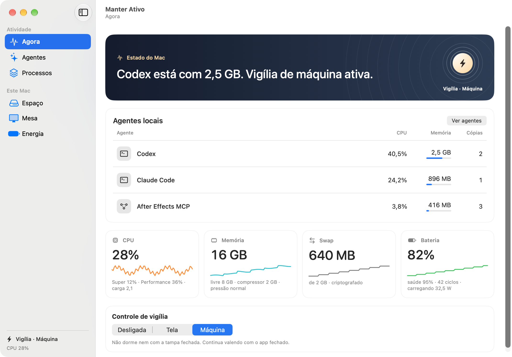
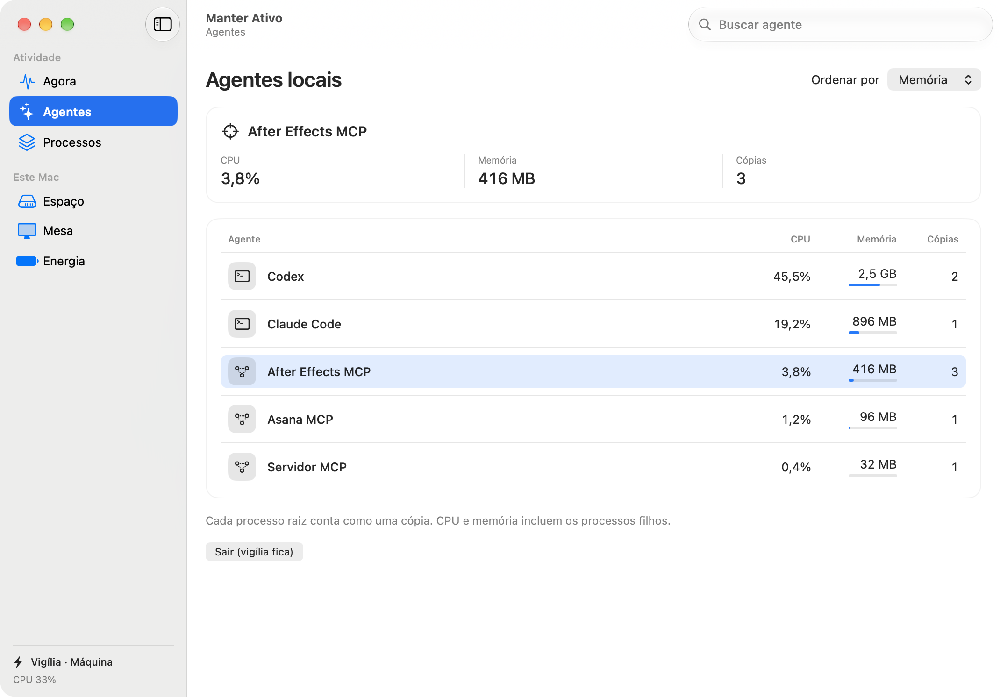

# Manter Ativo

**Quais agentes estão usando o seu Mac agora?** Veja a CPU, a memória e as cópias de cada agente local. Escolha quando o Mac pode dormir, inclusive depois de fechar o painel.

[English guide](docs/README.en.md) · [Demonstração de 20 segundos](docs/manter-ativo.mp4?raw=true) · [Instalação](#instalação)

<picture>
  <source media="(prefers-color-scheme: dark)" srcset="docs/painel-escuro.png">
  
</picture>

*Interface real em português, com dados de demonstração.*

## Da barra de menus ao processo

Abra **Abrir painel**. Em **Agora**, a frase resume o que merece atenção. Os três primeiros agentes aparecem por memória, junto das tendências de CPU, RAM, swap e bateria. Use **Ver agentes** para buscar por nome e ordenar por consumo ou por número de cópias.

Cada cópia corresponde a um processo raiz do grupo. Os filhos entram na CPU e na memória. Um agente com vários núcleos em uso pode passar de 100% de CPU. O painel lê apps assistentes, ferramentas de linha de comando e servidores MCP que executam neste Mac. Sessões em nuvem e abas do navegador ficam fora da contagem.



## Vigília

| Modo | Comportamento |
| --- | --- |
| **Tela** | Mantém a tela acesa. Fechar a tampa ainda pode colocar o Mac em repouso. |
| **Máquina** | Desativa o repouso do sistema. A vigília continua quando o painel fecha ou o app sai. |
| **Desligada** | Na bateria, o Mac volta a poder dormir. Na tomada, os tempos de repouso da máquina e da tela ficam em zero. |

O componente de energia pede autorização de administrador para a instalação. Os perfis **Mesa** e **Bolso** são sugestões aplicadas por confirmação.

## Instalação

O app tem como alvo **macOS 15 ou posterior**. A instalação disponível é pelo código-fonte. Para compilar, use um Mac com Xcode 26 ou posterior e a ferramenta de linha de comando do Xcode selecionada.

```sh
git clone https://github.com/guicunhaa/manter-ativo.git
cd manter-ativo
./script/build_and_run.sh --install
```

O instalador abre o painel em `/Applications/Manter Ativo.app`. Na primeira substituição, guarda a versão existente como `Manter Ativo (anterior).app`.

| Comando no diretório do projeto | Resultado |
| --- | --- |
| `swift test` | Executa os testes do núcleo. |
| `./script/build_and_run.sh --bundle` | Gera e verifica o app em `dist/`, sem iniciar nem instalar. |
| `./script/build_and_run.sh --cockpit` | Abre o painel compilado. |
| `./script/build_and_run.sh` | Inicia pela barra de menus. |

## O que fica no Mac

O painel funciona sem conta e sem telemetria. O histórico local guarda até sete dias de amostras. Regras opcionais de nomeação ficam em `~/Library/Application Support/Manter Ativo/agentes.json`. O [contrato do retrato local](HARNESS.md) descreve os arquivos de estado.

**Processos** permite buscar famílias e pedir encerramento. **Espaço** mede apenas as pastas do catálogo, sob demanda. **Mesa** mostra telas, USB e o que segura o sono. **Energia** informa pressão térmica, modo de energia e as leituras disponíveis da bateria.

## Projeto

Criado por Gui Cunha. [Licença MIT](LICENSE). Para relatar um problema, informe a versão do macOS, o que fez e o que esperava ver. Remova dados pessoais de qualquer captura antes de anexar. [Abrir uma issue](https://github.com/guicunhaa/manter-ativo/issues)
