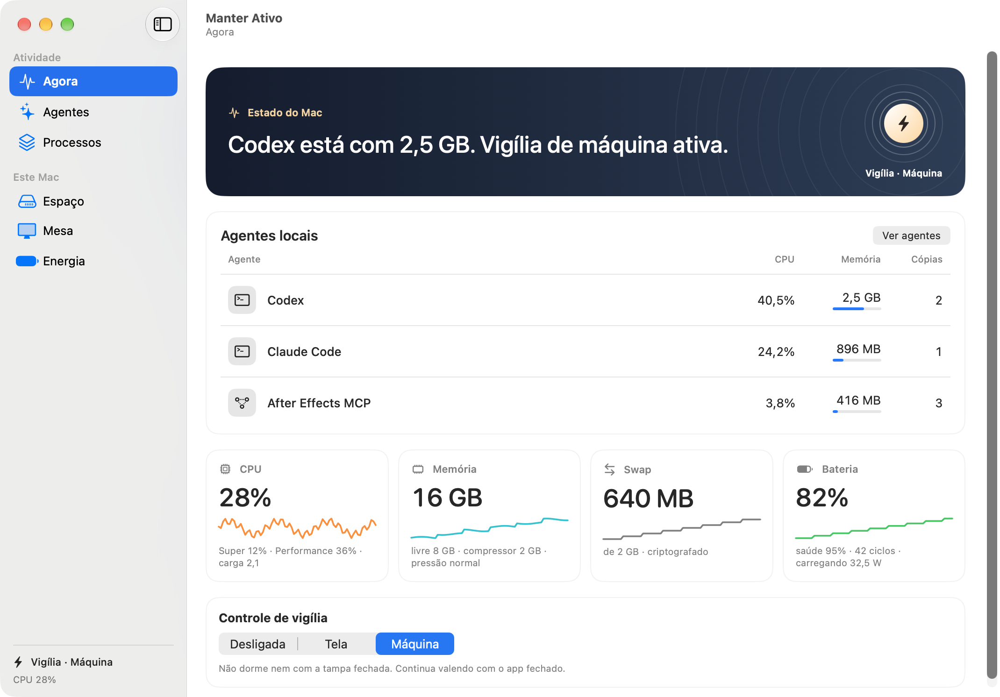

# Manter Ativo

**See which local AI agents are using your Mac.** A native SwiftUI menu bar app shows memory, CPU and root process counts for assistants, coding CLIs and MCP servers. Its keep-awake agent continues running after the panel closes.

[Português](../README.md) · [20-second walkthrough](manter-ativo.mp4?raw=true)

<picture>
  <source media="(prefers-color-scheme: dark)" srcset="painel-escuro.png">
  
</picture>

*The app interface is in Brazilian Portuguese. The screenshots and walkthrough use sample data.*

## Try it from source

The app targets macOS 15 and later. Building requires Xcode 26 or later with its command-line tools selected. A signed public download is pending.

```sh
git clone https://github.com/guicunhaa/manter-ativo.git
cd manter-ativo
./script/build_and_run.sh --install
```

Choose **Abrir painel** in the menu bar to open the dashboard. **Agora** shows the three largest agents by memory. Choose **Ver agentes** to search or sort the full list by CPU, memory or copies. Each root counts as one copy. Its children contribute their CPU and memory. CPU can exceed 100% when an agent uses multiple cores.

## Keep-awake modes

| Control | Effect |
| --- | --- |
| **Tela** | Keeps the display awake. Closing the lid can still put the Mac to sleep. |
| **Máquina** | Disables system sleep, even after quitting the app. Installing the power helper requires administrator approval. |
| **Desligada** | Restores sleep on battery. On external power, the system and display sleep timers stay at zero. |

**Mesa** and **Bolso** suggest desk and mobile settings. Changes require confirmation. Activity stays on the Mac. Detection covers local processes. Browser tabs and cloud-only agents are outside its scope.

## Build and test

Run `swift test` from the project directory. To build and verify a local app bundle without installing or launching it, run `./script/build_and_run.sh --bundle`. The result is in `dist/Manter Ativo.app`.

Maintained by Gui Cunha. [MIT license](../LICENSE) · [Issue tracker](https://github.com/guicunhaa/manter-ativo/issues)
